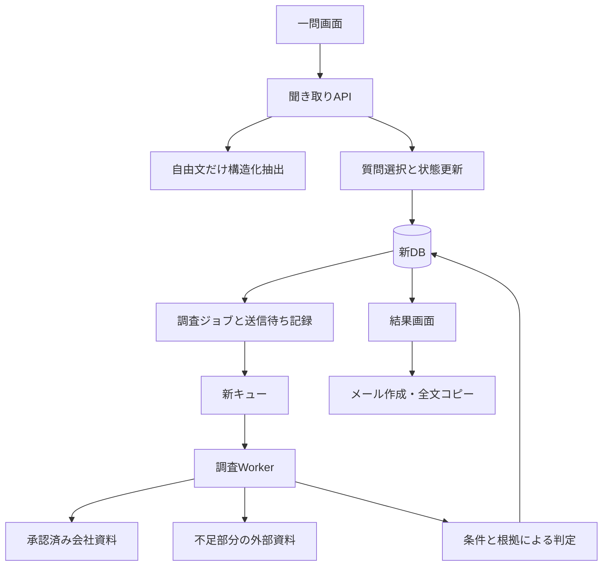

# 二段階の取扱可否確認システム 設計書

設計版1.1。2026年11月16日更新。実装名は `aoki-availability-v2`。お客様向け名称は「商品・製作の取扱確認」。実メールに基づく見直し根拠はREVIEW-20261116.mdに記載する。

## 1. 成果と範囲

お客様が、名称や仕様を完全に知らなくても、少ない入力で「この会社に相談を進められるか」を把握できることを目的とする。御社には、対象・用途・重要条件・不足情報・判断根拠がまとまった内容を残す。

顧客体験は二段階のみとする。

1. **聞き取り**：現在の質問と答える操作だけを中心に表示。必要情報を素早く集める。
2. **調査と結果**：聞き取った情報で一括調査。結論、短い理由、次のメール相談を表示。

価格比較、技術コンサルティング、対話による長い商品選定、正式見積、注文、仕入先への自動照会、メール自動送信は初期範囲外。技術条件は取扱可否に必要な範囲で収集し、適合性を保証しない。

「取扱対応可能」は、お客様の必須条件に対して会社の承認済み取扱根拠があること。在庫の確保や正式受注を意味しない。画面の肯定見出しは「当社で取扱対応できます」とし、無条件の「すぐ用意できます」は使わない。納期・数量確保を必須条件にした相談では、その条件が未確認なら担当者確認へ回す。

取扱分野として対象かと、今回の依頼条件を満たせるかは別に確認する。「製作相談の対象です。今回の図面の加工範囲と指定納期は担当者確認が必要です」のように、根拠がある部分と未確認部分を分けて返す。分野の対象判定にも有効な会社承認ルールが必要で、過去の照会や見積依頼があるだけでは対象と断言しない。

## 2. 既存システムからの独立

| 領域 | 新システムの境界 |
| --- | --- |
| コード | 空の新リポジトリから作成。旧chat、consultation、inquiry、検索補正、プロンプト、旧テスト期待値をコピー/importしない |
| 保存 | 新D1データベース、新R2バケット、新キュー。旧DBへの読み書き権限を与えない |
| セッション | 新ドメインに限定したCookie。旧conversationIdや履歴を受け付けない |
| 設定・秘密情報 | 新しい環境変数・bindings。旧サービスの本番キーを自動コピーしない |
| UI | 別URLの独立画面。既存チャット部品の改造やiframe内呼出しで済ませない |
| 元資料 | 会社が認めた原本・エクスポートだけ、独立した取込・承認を経て利用可能 |
| 旧会話・旧学習資産 | 自動移行しない。過去の失敗は受入ケースの題材に限り利用 |
| 切替 | 新URLの合格後、入口リンクの切替だけを別作業で行う。旧システムを削除しない |

同じCloudflareアカウントを使うことは可能だが、独立したリソースIDと権限を使う。インフラの独立だけでアカウント全体の利用枠も独立するとは扱わない。

## 3. 画面仕様

### 3.1 開始と聞き取り

初期画面は「どのような商品・加工・製作をご希望ですか？」、入力欄、写真・図面添付、少数の相談例。メーカー名・型番・用途・依頼範囲を自由に一度で入力できる。開始前の会員登録、氏名、メール、住所は要求しない。

開始欄の近くに「必要なことを短く伺ってから、取扱いを調べます」と示す。外部調査・AIへの必要情報の利用はプライバシー案内で示すが、毎問に承認ダイアログを置かない。

通常の聞き取り画面：

```text
商品・製作の取扱確認             [入力内容を確認・修正]

メーカー名は分かりますか？

[ メーカー名を入力                      ]
[ 次へ ]              [ 分からない ]

[ この内容で調べる ]
```

- 一つの質問、必要なら一文の補助、回答操作だけを主領域に表示する。
- 毎回のお礼、条件の長い復唱、推薦、検索結果、思考過程、内部の判定名を挿入しない。
- 回答履歴は「入力内容を確認・修正」に格納し、常時並ぶチャットログにしない。
- 選択肢は最大5個程度。自由入力を閉じない。「分からない」は一回で尊重する。
- 表示中の質問以外の情報も一緒に答えた場合は、取り出せた値を保存し、後で聞き直さない。
- 質問総数が動的に変わるため「あと必ず2問」等は表示しない。
- 操作直後は押下状態を表示する。更新失敗なら同じ入力を保持し、再試行を提示する。
- 写真は任意。文字だけでも進める。アップロードは聞き取りと並行し、内容解析は調査開始後。
- 型番が不鮮明でも、写真・図面・説明があれば進める。読めない文字を確定型番として補完しない。図面がある製作相談で、全寸法の手入力を求めない。
- 最低限の対象情報がない状態の「この内容で調べる」は、用途・名称・写真のいずれか一つを求める短い案内へ。空調査を開始しない。

PCもスマートフォンも同じ一問中心の構成。幅360px、キーボード表示、200%拡大、キーボードのみの操作で質問と入力が隠れない。フォームのラベルと更新通知を支援技術から読めること。

### 3.2 調査と結果

必要情報がそろったら、別の必須確認画面を挟まず調査へ進む。「この条件で取扱いを確認しています」と短い条件要約と修正操作を示す。

進捗表示は実行中の工程だけを使う。「登録情報を確認中」「資料を確認中」「結果を整理中」。架空の進捗率、動いていない調査の表示、逐次の長文出力をしない。

結果は次の順序とする。

1. **今回の結論**：取扱対応可能／担当者確認が必要／対応範囲外。
2. **分かったことと理由**：原則2文以内。取扱分野の判定と今回の未確認条件を併記する。分野の根拠がなければ「取扱分野も確認が必要」と示す。分野だけの一致を、今回の対応確約に見せない。
3. **確認した対象と条件**：折りたたみ可能。未確認項目も残す。
4. **根拠**：顧客向けに公開可能な説明のみ。公開資料はリンク・確認日を表示。
5. **メールで相談する**、**相談内容をコピー**、**条件を修正**。

複数品目は最大3件を同じ案件で扱い、品目別に結論を表示する。4件以上は未処理品目を明示し、別案件への分割操作を出す。黙って削除しない。複数品目の一部が対応可能でも、案件全体を対応可能と表示しない。

調査障害時の見出しは「調査を完了できませんでした」。業務上の「担当者確認が必要」と視覚的・内部状態とも分ける。入力は保持し、再試行とメール相談を出す。

調査で特定できた不足項目は結果の「条件を修正」から対象欄へ直接移動できる。自動で聞き取りを再開せず、unknown/skippedの回答を要求し直さない。追加入力・再調査は顧客の明示操作で行う。

## 4. 速度と入力負担

次の値は**設計上の受入目標であり、実測結果やサービスの保証値ではない**。プレビュー環境から国内の実端末で計測する。

| 指標 | 初期目標 |
| --- | --- |
| 操作への視覚反応 | p95で100ms以内 |
| 選択・短い定型入力から次の質問が操作可能になるまで | p95で500ms以内。モデル呼出し0回 |
| 自由文の抽出から次の質問が操作可能になるまで | p95で2.5秒以内。最大1モデル呼出し |
| 自由文抽出のタイムアウト | 3秒で打切り。入力保持と定型の補助質問へ。黙って解釈成功としない |
| 調査開始の応答 | 1秒以内にjob状態を返す。調査本体をHTTP受付で完了させない |
| 調査結果 | 正常系p95で30秒以内を目標。キュー待ちを含め60秒で明示的に終了扱い |
| 質問数 | 開始入力後0〜4問を目標。最大6問／案件。訂正のために顧客が自発的に開く操作は別集計 |

全項目を埋めさせるフォームにしない。6問の上限には曖昧さの確認も含める。上限到達で対象の手掛かりがあれば不足のまま調査へ進み、なければメール相談へ進む。正常系の数字と失敗・離脱を分けて報告し、失敗を除いた速さだけで合格にしない。

## 5. 聞き取りエンジン

### 5.1 基本方針

質問文・質問順序・終了条件はアプリのルールが決める。LLMは自由文から型に沿った変更案を取り出す役割に限定する。質問を毎回生成させない。LLMが取扱可否、調査開始、メール送信を確定してはならない。

開始入力の各品目を4つのプロフィールへ分類する。プロフィールは品目ごとに保持し、型番品と製作品が一案件にあっても同じ質問順にしない。商品カテゴリはプロフィールとは別の自由な分類であり、分類一覧にない商品でも相談できる。

| プロフィール | 最低限の調査材料 | 必要なときにだけ追加する情報 |
| --- | --- | --- |
| `known_model` | メーカー＋型番、または単独で検索対象になる型番・商品名 | 同型番の曖昧さ、仕様違い、必須数量 |
| `replacement` | 部品の説明・用途、またはアップロード済み写真 | 寸法、材質、取付、使用環境、数量 |
| `fabrication` | 作りたいもの・用途の説明、または図面 | 概寸、材質、加工内容、数量 |
| `unknown` | 探しているものの説明、または写真 | まず用途。識別に効く形状・寸法などを順に一つ |

メーカー＋型番が最初からそろい、承認ルールに追加必須条件がなければ0追加質問で調査へ。数量、連絡先、納入先を一律の必須項目にしない。顧客が自発的に伝えた納期等は保存し、無視しない。

プロフィールとは別に、依頼範囲 `request_scope`（商品・材料の購入／加工／製作）と、加工・製作時の材料手配 `material_supply`（客先支給／当社調達／一部支給）を保持する。入力から明確なら再質問しない。不明で、回答によって適用する取扱ルールや依頼の意味が変わるときだけ聞く。購入相談には材料支給の質問をしない。

「材料を購入したい」はpurchase、「支給材に穴を開けてほしい」はprocessing＋customer_supplied、「材料を調達して穴加工も」はprocessing＋company_sourced。製作品の一括依頼はfabricationとし、図面のどこを製作するか・塗装や支給部品など、判断に影響する不足を優先する。材料手配の違う方式を同じ対応可否として扱わない。

### 5.2 質問選択の決定手順

サーバーは読み取り専用の質問設定と、そのカテゴリの承認済み取扱ルールが必要とする属性名を利用できる。これは設定参照であり、第1段階での外部検索・資料読取・画像解析を開始するものではない。

```text
1. 顧客の入力を検証し、対象を明確にできる変更だけ保存する。
2. 対象の手掛かりがなければ、名称・用途・写真のいずれかを求める。
3. 顧客が「この内容で調べる」を押したら、手掛かりを条件に調査へ。
4. 6問に達したら、手掛かりがあれば不足を保持して調査へ。
5. 候補質問から回答済み・unknown・skipped・not_applicableを除く。
6. 次の優先順位で、判断に影響する質問を一つ選ぶ。
   a. 別商品・別部品を混同する重大な曖昧さ
   b. 依頼範囲・支給/調達の違いが判断を変える場合、その不足
   c. 承認済み取扱条件が要求する必須属性
   d. 識別のためのプロフィール既定項目（追加は最大2問）
7. 該当がなければ不足があっても調査へ。
```

承認ルールがまだないカテゴリは、用途等を集め続けない。依頼範囲の確認も含め、既定の補助質問を最大2問に抑えて調査する。追加質問例は「材料の購入と加工のどちらをご希望ですか？」「材料はお客様からの支給ですか？」「図面のどの部分をご依頼ですか？」。一つの質問に5項目を詰め込まない。

### 5.3 不明・訂正・複数対象

- フィールドは `not_asked / known / unknown / skipped / not_applicable / conflict` を区別する。
- unknownとskippedは聞き直し禁止。後から顧客が値を述べた場合はknownへ更新できる。
- 値は品目ID＋属性キーで所有する。「ガラス」と「パッキン」を同じ材質欄へ入れない。
- 「ガラス外径」と「見える穴の径」、「通常温度」と「最高温度」は別属性。
- 明示訂正は旧値を現在値から外し、変更イベントにのみ残す。推定で別属性の値を消さない。
- 更新対象が一意でなければ適用せず、確認質問を一つ出す。6問上限ならconflictを保持して調査する。
- 提案、仮定、比較候補を顧客の確定条件にしない。顧客申告と資料確認済み事実も分ける。
- 型番などを修正したら関係する調査を無効化する。無関係な数量や品目を消さない。
- 共通の使用条件を複数品目へ適用するのは、顧客が共通と明示した場合だけ。同じ入力イベントを根拠に各品目へ保存し、訂正対象も明示された品目に限定する。
- 塗装・配送先・製作除外が部品ごとに違う場合は、カバーとネックなどを別itemIdで保持する。数量の「組」は図番・構成・単位に結び付け、異なる大きさや部品の数量へ自動展開しない。3品目上限を超える細分化が必要なら入力を保持して分割する。
- 最新図面の指定は、顧客の明示した対象と改訂関係を保存する。ファイル名に「旧仕様」があっても名前だけで新旧を決めず、差し替えた図面からの旧寸法が現在値へ復活しないよう無効化する。

### 5.4 モデル利用契約

自由文抽出への入力は、現在の質問ID、現在の構造化情報、最新発言、必要な直前の一往復まで。全会話を毎回再送しない。出力はprofile候補、対象追加・訂正、フィールド変更、短い根拠引用、曖昧さのみ。

ユーザー・資料内の命令をシステム指示として扱わない。型検証、引用範囲、単位、所有品目、許可属性をサーバーで検証する。検証できない値を原文全文に置換してknownへ格納する救済を作らない。残った自由文はnotesとして保持できるが、自動判定の肯定根拠にはしない。

選択式、数値欄、メーカー・型番専用欄は決定的な処理を優先する。自由文で失敗した場合は再生成ループを回さず、入力を保持して選択・短い入力に切り替える。API利用枠不足は運用エラーとして記録し、架空の通常回答で隠さない。

モデル名は環境設定の `INTAKE_MODEL` と `RESEARCH_MODEL` に分離。実装時点で使えるモデルを同じ日本語ケースで計測し、聞き取りは速度と抽出品質を満たす最小のものを選ぶ。モデルの流行や単価だけで決めない。

### 5.5 属性と質問設定

属性名を会話ごとに自由生成させない。初期辞書には次を定義し、単位・値の型・質問文・プロフィールでの優先度を持たせる。質問ポリシー版を案件へ保存する。未知の専門属性はnotesへ保持し、承認された辞書追加まで自動判定の根拠にしない。

| 属性キー | 意味・質問例 |
| --- | --- |
| manufacturer / model / product_name | メーカー／型番／商品名。それぞれ別欄 |
| purpose / description | 用途／名称不明品の説明。「何に使うものですか？」 |
| material / process | 材質／依頼する加工。「材質は分かりますか？」 |
| request_scope | purchase（商品・材料購入）／processing（加工）／fabrication（製作）。不明はフィールドのunknown等で表す |
| material_supply | customer_supplied（客先支給）／company_sourced（当社調達）／mixed（一部支給）。単なる購入はnot_applicable。不明を既定で当社調達にしない |
| work_scope / excluded_work / supplied_parts | 依頼する部位・作業／製作除外／支給部品。品目ごとに保持 |
| drawing_number / drawing_revision / coating | 図番／顧客が指定した図面版／塗装仕様。ファイルの実在・解析状態は添付管理で別に検証 |
| outer_diameter / inner_diameter / opening_diameter | 外径／内径／見える穴径。対象を示して一つずつ聞く |
| width / height / depth / thickness | 幅／高さ／奥行／厚さ。概寸は概寸として保持 |
| normal_temperature / peak_temperature | 通常温度／最高温度 |
| peak_duration / peak_frequency | 最高温度の継続時間／頻度 |
| pressure / fluid / mounting | 使用圧力／流体／取付方法 |
| quantity / required_date / destination | 数量と単位／希望日／納入先。必要時のみ質問 |

初期の追加質問順は、known_modelがメーカー→型番の不足側、replacementが用途→取付または識別に必要な寸法、fabricationが依頼部位・作業範囲→判断に必要な概寸、unknownが説明→用途。依頼範囲・支給/調達が曖昧なら5.2の優先順位で確認する。既に回答済みなら飛ばし、図面に記載済みと顧客が述べた寸法は解析前に一律再入力させない。数量はルールが要求する時だけ追加する。

request_scopeとmaterial_supplyのknown値はValue.textに上記の英語コード、number/unitはnullで保存し、根拠引用は原入力の日本語等を保持する。他の作業範囲・塗装等は許可辞書の文字列属性とする。スキーマはFieldKeyの構文だけを検査するため、許可キー・列挙値と、意味に応じたnot_applicableの妥当性はランタイムでも検証する。

`hardConstraint`は顧客が必須と述べた条件、および指定商品の同一性を決める型番・寸法・材質等にtrueを付ける。顧客が「任意」「変更可」と述べた条件はfalseにできる。明確に述べた仕様をfalseにして照合を省略しない。knownは顧客申告の確定であり、当社による技術的な確認済みという意味ではない。

## 6. 調査と判定

### 6.1 凍結する調査入力

調査開始時の案件を `ResearchBrief` として凍結する。案件ID、入力revision、品目ごとのプロフィール・現在条件・不明点、使用する会社資料のknowledgeRevision、添付参照を含む。後から会話文を読み直して条件を再構築しない。

### 6.2 調査の順番

1. 凍結した条件で、承認済み会社データの型番・別名・カテゴリ・適用範囲を検索。
2. 肯定／否定を判断できるか、未確認の必須条件と根拠の不足を機械的に特定。
3. 必要な場合だけ、承認済み資料、仕入先の許可された資料、公開メーカー資料を調べる。外部検索は識別・仕様の補足に使う。
4. 写真・図面を添付している場合はこの段階で解析。読めない箇所を推定で埋めず未確認にする。
5. 型番・仕様・条件・原資料の箇所を対応づけたEvidenceを作る。
6. 決定的な判定器で品目別の結論を作る。
7. 公開可能なフィールドだけを取り出したPublicResultを保存・表示。

登録資料だけで判定できれば外部検索を行わない。新たなWeb候補は社内の承認済み調達先へ自動昇格させない。公開検索に会社名・個人名・図面原文・仕入先の秘密情報を混ぜない。

初期上限は1ジョブにつき外部検索2回、本文取得4件、本文取得の同時実行2件、調査LLM最大2回、画像/PDF解析最大1回。すべて60秒の共通期限と共通予算内で行う。3品目でも上限を品目数倍にしない。未調査品目を理由付きの担当者確認として残せるが、全体の処理状態はpartialとする。

### 6.3 会社の判断資料

承認済みの `CapabilityRule` を中心にする。最初はCSV/JSON取込＋簡単な管理画面で運用し、ベクトルDBや巨大な知識グラフは導入しない。

ルールが必要とする情報：

- ルールID、対象商品またはカテゴリ、型番・名称・別名。
- 判断種別：`supported / excluded / review_only`。
- 判定の対象：`assessmentScope=business_scope`（取扱分野）または`request`（今回の個別依頼）。分野だけの承認を個別依頼の肯定へ使わない。
- 対象となる属性条件、追加で確認すべき属性、適用範囲。
- 承認者、承認日時、有効期限、元資料ID・版・頁／行。
- 根拠として使える顧客向け説明と、社内のみの注記。

条件式は任意JavaScriptを保存せず、許可した `eq / in / range` のみ。単位換算は単位辞書による。型式の末尾違い、内外径、温度種別等を曖昧一致だけで同一にしない。広いルールと狭いルールが衝突すれば担当者確認へ回す。例外を優先するには管理者が競合を解消した新しい版が必要。

`requiredFields`は当該ルールの肯定判断前に値の確認が必要な属性、`coveredFields`はその資料が対応範囲を保証できる属性。requestルールでは顧客のhardConstraintがcoveredFieldsに含まれなければ肯定しない。business_scopeルールは分野の適用条件を照合し、個別の納期等を満たしたとは主張しない。coveredFieldsへの登録自体も承認対象で、資料にない属性をモデルが補わない。predicatesはANDで評価し、rangeは単位を正規化した閉区間とする。未知値・競合値は一致にしない。coveredFieldsにある属性の範囲制限を省く場合は、その範囲に制限がないという会社の明示的な承認根拠が必要。

内部Evidenceには、id、itemId、sourceIdと版、claimの対象と属性、正規化した値、原文抜粋、頁／表の行と脚注、取得日時、有効期限、検証結果、公開可否を持たせる。CapabilityRuleの承認根拠と、外部ページの仕様確認根拠は別種別で保持する。公開APIにはPublicEvidenceだけを生成する。

仕入先一覧は調査先・分野の参考になるが、それだけではsupportedを作らない。過去メールは案件・日付・条件付きの参考情報。現在の一般販売条件には転用しない。管理者の承認がない資料はdraft扱い。

過去メールの取込候補には、売り手/買い手/照会先の役割、対象案件、当時の日付、照会・見積・受注等の確認段階、辞退理由・適用範囲を記録する。顧客から依頼された事実や仕入先の「確認中」は、受注実績・現在の対応可能を意味しない。自社建物の保守を購入したメールを、自社がそのサービスを提供する根拠にしない。

過去事例からの一般化には会社による現在の取扱方針の承認が必要。工場負荷による一時辞退、特定工場の客先支給材加工不可を、全期間・全調達方式のexcludedへ広げない。個別依頼のルールは対象のrequest_scope、必要なmaterial_supply、部位・除外を条件に含める。単に「加工不可」と登録しない。

有効期限は登録時に明示する必須項目。実装担当が会社の代わりに「90日間有効」等を自動承認しない。期限切れ・撤回・未承認のルールは肯定／否定に使わない。

### 6.4 判定表

品目ごとに二つの結果を保存する。

- `scopeAssessment`：business_scopeルールによる `in_scope / out_of_scope / unconfirmed` と公開理由・根拠。対象分野を確認した結果であり、今回の条件の適合保証ではない。今回の全必須条件に一致する有効なrequestのsupportedルールは、その個別依頼が取扱対象である根拠にも使える。この場合は同じ公開根拠を両欄に参照でき、二重登録を要求しない。
- 既存の `verdict`：requestルールで顧客の必須条件を照合した `can_handle / needs_review / out_of_scope`。案件全体の結論はこの値から集約する。

両者の根拠は別々に検証する。business_scopeしか一致しなければ、個別依頼はneeds_review。分野内で今回の方式だけ対応外ならin_scope＋out_of_scopeも可能。分野自体がout_of_scopeなのに個別依頼がcan_handleなどの矛盾は解消まで個別依頼をneeds_reviewにする。公開表示を生成するモデルにこの組合せを再判定させない。

肯定/否定の競合は、同じassessmentScopeと適用範囲の中でまず判定する。分野のsupportedと、特定方式のrequestのexcludedは、それだけでは競合ではない。個別依頼をcan_handleにする場合、scopeAssessmentもin_scopeであることを契約で検証する。

| 条件 | 品目の結論 |
| --- | --- |
| assessmentScope=requestの有効なsupportedルールが対象・依頼範囲・必須条件すべてをカバーし、矛盾がない | `can_handle` |
| assessmentScope=requestの有効なexcludedルールが対象・今回の方式・条件に一致し、矛盾がない | `out_of_scope` |
| 分野だけ一致、型番未確定、必須条件不足、取引承認なし、資料不足、期限切れ、矛盾 | `needs_review` |
| Web上で候補を見つけただけ | `needs_review` |
| 検索結果0件 | `needs_review` |
| 外部調査失敗で必要根拠が得られない | 結論を確定できない品目は `needs_review`、処理状態はpartialまたはfailed |

自信スコア、LLMの「可能だと思う」、型番の一部一致は肯定／否定の根拠にならない。数値が資料に存在するだけで一致とせず、対象・属性・単位・条件・行を照合する。資料の表と脚注は一緒に保持する。

案件全体の結論：全品目can_handleならcan_handle、全品目out_of_scopeならout_of_scope、その他はneeds_review。`status=failed`では全体verdictをnullとする。システム障害があっても別の品目で確定した有効な結果は保持するが、全体の「確認完了」とは表示しない。

### 6.5 結果の期限・更新

結果は入力revisionとknowledgeRevisionに結び付ける。条件修正、根拠撤回・変更・期限切れでstaleにする。scopeAssessmentとverdictの両方を、結果取得時とメール文生成時に再確認する。古い結果は参考履歴としてのみ表示し、肯定の最新結果として復活させない。

失効を確認できない障害時も古い肯定を現在の結論として返さない。ジョブ完了後に知識更新があれば再調査操作を出す。自動再調査を無限に続けない。

## 7. アプリ構成

独立したTypeScriptアプリを推奨する。

| 構成 | 採用案 | 役割 |
| --- | --- | --- |
| UI | React＋Vite、通常のフォームとCSS | 一問画面、結果、修正、管理画面 |
| API・配信 | Cloudflare Worker＋Static Assets。薄いHTTPルーター | 同じ新URLで静的UIとAPIを配信 |
| データ | 新しいD1 | 案件、変更、ジョブ、会社ルール、結果、監査 |
| 非同期調査 | 新しいCloudflare Queue＋consumer Worker | ブラウザ切断から独立した調査 |
| 添付 | 非公開R2 | 写真・PDF、原資料 |
| 検証 | Vitest、Playwright、JSON Schema validator | ロジック、API、実UI、契約 |

WorkerでUI資産とAPIを配信する構成は[公式Static Assets資料](https://developers.cloudflare.com/workers/static-assets/)に基づく。依存バージョンは実装開始時に公式テンプレートで互換性を確認しlockfileへ固定する。特定の「最新版」番号をこの文書に決め打ちしない。

最初はローカルのD1/R2/Queueエミュレーター、偽検索アダプター、架空ルールで一連の流れを完成させる。外部のアカウント作成や料金プラン変更は実装着手の前提にしない。ホスティングの契約条件が合わなければ、UIや判定器を変えず各adapterを置き換える設計とする。



一つのリポジトリ内で `domain/`（質問・判定・状態）、`adapters/`（保存・AI・検索・キュー）、`http/`、`ui/` を分離する。domainは旧サービス、ブラウザ、Cloudflare固有APIを直接参照しない。

## 8. 状態・保存・同時実行

### 8.1 状態遷移

画面の二段階と内部状態を混同しない。内部状態は `collecting → researching → completed | partial | failed`。顧客の修正でcollectingへ戻り、既存jobをsupersededにする。案件の期限でexpiredとなる。

必要十分な変更イベントと最新スナップショットを保存する。全面的なイベントソーシング基盤は導入しない。回答文に埋め込んだスナップショットを次ターンの正とする設計は採用しない。

### 8.2 主なテーブル

| テーブル | 主な列・制約 |
| --- | --- |
| cases | id、ownerSessionHash、revision、phase、briefJson、questionPolicyVersion、knowledgeRevision、createdAt、expiresAt |
| case_events | id、caseId、mutationId、fromRevision、toRevision、変更内容、原発言参照。caseId＋mutationIdを一意 |
| research_jobs | id、caseId、inputRevision、knowledgeRevision、attempt、状態、deadlineAt、leaseToken、leaseUntil、snapshotJson、usage。caseId＋inputRevision＋knowledgeRevision＋attemptを一意 |
| research_outbox | jobId一意、queuedAt、retryAt、attempts。DB保存とキュー送信の隙間を埋める |
| evidence | id、jobId、itemId、原資料ID、該当箇所、検証状態、公開範囲、有効期限 |
| results | jobId一意、inputRevision、knowledgeRevision、internalJson、publicJson、createdAt |
| sources / capability_rules | 資料版・承認状態・公開範囲・有効期限・条件。更新でknowledgeRevisionを増やす |
| attachments | id、caseId、objectKey、MIME、byteSize、検証状態、expiresAt |
| audit_events | 管理者操作、判定根拠ID、失敗コード、時間、利用量。秘密本文を記録しない |

`briefJson`はcontracts.schema.jsonのResearchBriefを基準にする。開始入力前のrevision=0の案件ではbriefJsonをnullとし、最初の有効入力で品目を作りrevision=1とする。保存用の所有者・鍵・社内資料は公開契約に入れない。

### 8.3 更新とジョブ実行

各更新は `mutationId` と `expectedRevision` を持つ。同じmutationIdの再送は同じ応答を返す。revision不一致は409を返し、UIで最新版へ同期してから再適用する。最後に来たリクエストで無条件上書きしない。

状態更新・イベント・必要ならjob/outboxの作成は一つのDB batchにまとめる。D1のbatchはSQL文群をトランザクションとして扱う。[公式batch仕様](https://developers.cloudflare.com/d1/worker-api/d1-database/#batch)

ただし条件付きUPDATEが0行でもSQLエラーとは限らない。revisionの比較更新成功を後続のイベント/job INSERTの条件にも使う、または制約違反で全体を失敗させるなど、CAS失敗時に副作用が残らない実装にする。並行更新の結合試験で立証する。

commit後にoutboxからqueueへ送信し、送信成功を記録する。送信と記録の間で停止して二重配信されても安全にする。未送信outboxは定期処理で回復させる。新着の即時送信を定期処理待ちにしない。

Queueは少なくとも一回の配信で、重複が起こり得る。[公式配信保証](https://developers.cloudflare.com/queues/reference/delivery-guarantees/) consumerはjobIdによる完了済み判定と期限付きleaseで同時実行を抑止する。期限切れleaseを引き継ぐ場合はleaseTokenを更新し、旧実行者が結果をcommitできないようにする。

外部モデル呼出し後・保存前のクラッシュでは外部課金の重複を完全には保証できない。外部APIの冪等性があれば使い、なければ呼出し予約と実績を保存し、不明な利用量も上限に算入する。復旧のたびに上限をリセットしない。

result commit時に、現在のcase revision、job lease、knowledgeRevision、deadline、失効状態を再検証する。旧条件の遅い結果が新画面へ上書きされないこと。入力変更後は旧jobを停止可能な範囲で止め、停止できない通信の結果は破棄する。

利用者の明示再試行は新attemptとする。案件ごとの累積上限も確認する。自動再試行は一時的なネットワーク障害だけ最大1回、共通期限内。利用枠不足、認証失敗、スキーマ不正を自動ループしない。

## 9. API契約

同じ新originの `/api/v2/` に配置。すべての案件APIで匿名セッションの所有権を検証する。公開入力の型はschemaのAnswerMutation、応答の基本型はIntakeResponse / PublicResultを使う。

| API | 意味 |
| --- | --- |
| POST /cases | 空案件作成。初回作成もIdempotency-Keyで再送を識別 |
| GET /cases/:id | 現在revision、質問、顧客向け入力内容、phase |
| POST /cases/:id/answers | 一回答を保存。次質問またはresearch_startedを返す |
| PATCH /cases/:id/fields | 顧客が明示した品目・属性の修正。対象ID、expectedRevision、mutationId必須 |
| POST /cases/:id/research | 「この内容で調べる」または失敗後の再試行。準備判定と累積上限をサーバーで実施 |
| GET /cases/:id/jobs/:jobId | 所有権、工程、処理状態。内部エラー詳細は返さない |
| GET /cases/:id/result | 現在条件と有効な資料版に対応する公開結果。staleなら新しい肯定を返さない |
| POST /cases/:id/attachments | MIME・サイズを検証して非公開保存。アップロード処理自体も冪等化 |
| GET /cases/:id/attachments/:attachmentId | 所有者または認証済み管理者のみ。公開URL化しない |
| POST /cases/:id/mail-draft | 顧客向け確定条件から件名・本文・mailtoを作る。送信処理ではない |
| DELETE /cases/:id | 案件と添付の削除予約、アクセスの即時無効化 |
| /api/v2/admin/* | 管理者のみ。ルール取込・検証・承認・撤回、案件閲覧、運用状態 |

案件作成や回答の応答は `Cache-Control: no-store`。全更新にOrigin検証とCSRF対策を適用し、CookieはSecure・HttpOnly・SameSite。Cookie値自体をモデル入力や監査ログへ入れない。

調査中のpollは最初1秒、その後2秒、長期は5秒へ。画面非表示なら抑制。再表示時に現在jobを取得する。poll失敗や画面閉鎖で調査を再作成しない。

エラーコードは `INVALID_INPUT / REVISION_CONFLICT / NOT_OWNER / RATE_LIMITED / MODEL_UNAVAILABLE / RESEARCH_TIMEOUT / UPLOAD_FAILED / CONFIG_MISSING / EXPIRED` 等に分ける。顧客には短い日本語と復帰操作を表示する。調査の業務結果とHTTP/API障害を同じenumにしない。

## 10. メールへの引継ぎ

初期版はサーバーからメール送信しない。お客様の操作でメールソフトを開き、通常のメール相談を始められるようにする。メール環境がない場合の全文コピーも同等に扱う。

件名例：`商品・製作の取扱相談（照会番号 AV-...）`

本文の順序：相談対象、依頼範囲と支給/調達、用途、部品ごとの現在条件・除外・図面版、数量等の希望、不明事項、取扱分野と今回の依頼の確認結果・確認日時、顧客が追記できる欄。部品ごとの塗装・配送先の違いを維持する。撤回された旧値、仕入先名、社内資料本文、原価、API情報を入れない。調査失敗なら「調査未完了」と明記する。

宛先は会社確認済み設定 `CONTACT_EMAIL` のみ。未設定ならコピーは利用でき、メール起動は準備中とする。本番公開前の必須設定とする。実装者が旧資料からメールアドレスを推測して確定しない。

URLは正しくpercent-encodeする。mailto全体が設定した互換性上限を超える場合は、全文コピーを主操作にし、メール起動には短い件名と照会番号だけを入れる。本文を黙って切り捨てない。初期の互換性上限はUTF-8 URI長1,800バイトで保守的に設定し、実端末試験で調整する。これは全メールソフトの共通上限という意味ではない。

添付は自動添付されない。結果画面とメール文で必要なら「写真・図面はメールにも添付してください」と一度だけ案内する。内部のR2 URLや秘密の閲覧URLをmailtoへ含めない。照会番号は管理者検索のキーであり、他人が案件を読める認証情報にはしない。

メールボタン押下は `mail_opened`、コピーは `draft_copied` として記録できるが、受付済み・送信済み・見積依頼済みにはしない。

## 11. 資料整備と管理

初期管理画面は、承認済み取扱ルール、相談一覧と要約、調査失敗・未判定理由に絞る。見積・注文・顧客管理を新たに作り込まない。

管理者は原資料から手動またはCSV/JSONでルール案を登録し、プレビューで対象・条件・根拠を確認して承認する。元資料ファイルは別途添付できる。汎用Excel/PDFの全自動知識化は初期必須にしない。画像・PDFの解析結果は下書きであり、承認を代行しない。

公開APIはallowlist方式のDTOで組み立てる。internalJsonをコピーして機密項目を消す方式を使わない。社内資料に基づく根拠は承認済みの公開説明に変換し、仕入先名やURLを出さない。

会社の実資料が未投入ならデモ環境と明示する。架空例を実際の取扱範囲として公開しない。本番公開には、公開予定分野ごとの承認済みルール、対応可能・対応外・確認必要の代表ケース、担当者の判断一致確認が必要。

既存会社確認事項は `/home/uta/aoki-product-discovery-20261026/docs/COMPANY_QUESTIONS.md` を参照する。Q007（承認担当）、Q008（メール等）、Q013/Q014（公開・切替）、Q015（予算）、Q016（情報利用）、Q017（資料）、Q018（保守）を利用し、同じ内容の新質問票を作らない。この設計書は旧ファイルを変更しない。

## 12. 添付・権限・保管

添付は初期版でJPEG/PNG/WebP/PDF、1件10MB、1案件3件まで。種類・実データ・サイズを検査し、SVG/HTMLや不明な実行可能ファイルを受け付けない。PDFはダウンロード扱いを基本とし、インライン実行コンテンツを描画しない。R2は非公開とし、API経由で所有権確認後に取得する。

添付はアップロード完了と内容理解を分ける。OCR不能・画像の文字が不鮮明・解析時間切れはattachmentの解析状態に残す。写真だけで候補を推測できても、特定商品の承認根拠に自動昇格しない。

管理画面は独立したCloudflare Access等の検証済み管理者認証で保護し、APIもJWTの署名・issuer・audience・期限を検証する。未設定なら管理APIは閉じる。ローカル開発の代替認証はループバック環境限定で、本番では起動を拒否する。

試用時の暫定保管設定は案件・添付30日、本文を含まない運用メトリクス90日。会社確認前の提案値であり、本番公開前にQ016/Q018の決定へ合わせる。期限は作成時から数え、閲覧だけで延長しない。削除はAPI即時拒否と非同期物理削除で行い、残存添付を回収する検査も用意する。

外部AIへは必要な属性・必要な添付だけを渡す。会社資料の公開可否とは別に外部AIへの利用許可を持つ。ログに生の図面・顧客の全発言・メールアドレス・秘密キーを出さない。モデル出力や取得ページ内の命令により、資料権限や送信先を変更させない。

## 13. 運用と失敗時

- 聞き取りと調査の呼出し数、待ち時間、課金対象の利用量、未知の利用量、エラーを別集計する。
- 同じ案件の連打・再読込・重複キュー配信で調査が増えないこと。
- セッション単位の頻度制限と全体利用上限を持つ。IP制限だけに依存しない。
- 利用枠不足時は追加モデル呼出しを停止し、入力保持・手動入力・メール文コピーを維持する。
- 管理者は外部調査停止スイッチを持つ。停止中も有効な登録データだけの判定とメール文作成は動かせる。
- 検索・モデル提供元はadapterで分離する。自動で高額モデルや別有料サービスへ切替しない。
- 公開切替は新入口URLへのリンク変更に限定し、問題時は元の入口へ戻せるようにする。

## 14. 検証と公開条件

ACCEPTANCE.mdを唯一の合格判定表とする。自動テスト合格、実モデル抽出、実資料の判断一致、実UIの使いやすさを分けて報告する。

まず架空データで全経路を検証し、次に承認済み実資料でローカル／制限付きプレビューを評価する。実利用の代表相談を同じ条件で現行版と比較し、時間・質問数・離脱・判定の正しさを測る。改善率や費用節減を測定せずに書かない。

公開・料金変更・既存入口切替は、完成したプレビュー、検証結果、使用する実資料、戻し方を提示した後に実施判断する。設計書の作成依頼や旧チャットの過去の承認を公開の承認に転用しない。
